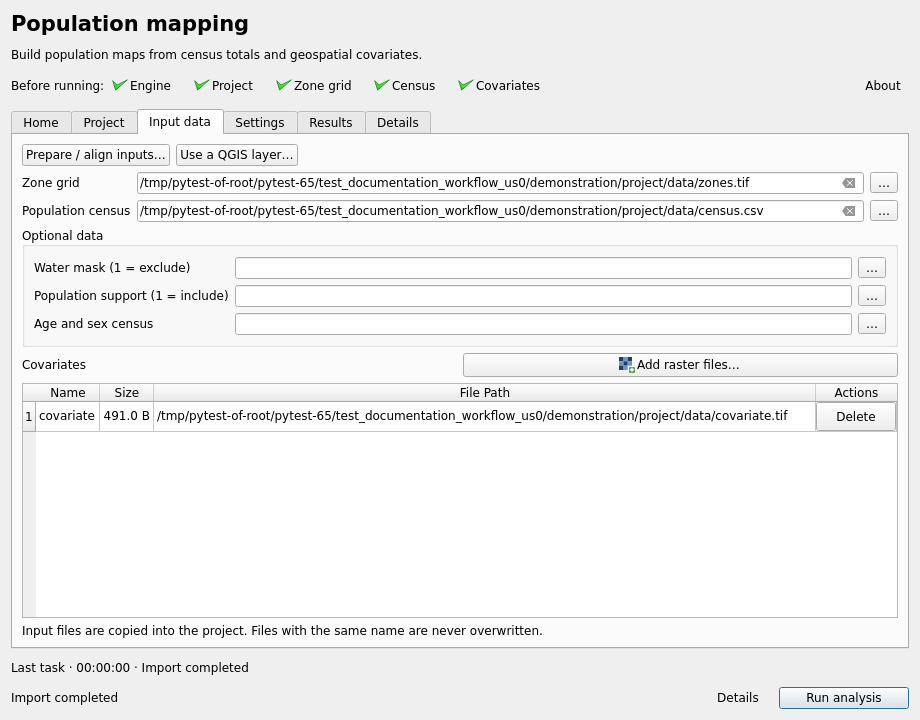
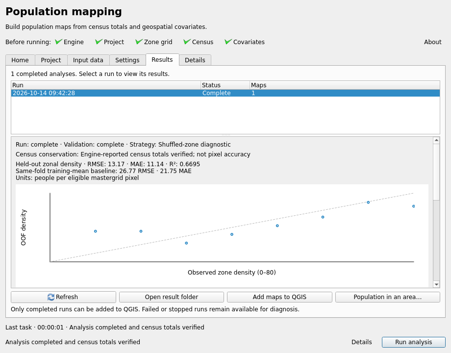

[](https://doi.org/10.5281/zenodo.14867059)

# QGIS pypopRF

pypopRF turns census-zone population totals into gridded population maps inside
QGIS. It fits a Random Forest to aligned geospatial covariates, then redistributes
each zone's total across eligible pixels. Water/support masks and age-sex maps
are optional. Every completed population map is checked against the census totals.

This checkout is the **0.3.2 development build**, not a published
stable release. The [development guide](docs/development.md) describes the
architecture, regression checks and packaging. Build a ZIP from this checkout;
there is no published download of this development build.


## A look at the workflow






These are real native-QGIS windows with **synthetic demonstration data**, not
evidence of population-map accuracy in a real area.

## Features

- A headless numerical engine runs in its own Python process, separate from QGIS.
- Every analysis has a new run directory, manifest, effective settings and input
  fingerprints. Source files and earlier results are not overwritten.
- Population sums are verified against each census zone and demographic group
  before a map is published. Invalid grids or unsupported positive-population
  zones fail explicitly.
- Windowed raster processing, bounded task submission, cooperative cancellation
  and owned-process cleanup replace whole-raster and GUI-thread processing.
- Default evaluation holds out spatial blocks and refits selection/preprocessing
  inside each fold. Conservation is not proof of pixel-level accuracy; validation
  limitations are described in the [settings guide](docs/user-guide/settings.md).
- A guided Home screen restores the project logo, next steps and About/citation.
  Compatible Python installations are offered instead of requiring file browsing;
  setup errors are shown next to the controls. Python is not silently installed.
- Import name conflicts offer verified reuse or a separate copy, never overwrite.
- A native-palette interface provides Home, Project, Input data, Settings, Results and
  Details tabs, clickable readiness checks, separate task status and progress,
  engine setup, elapsed stage history and run history that keeps your selected result.
- Guided data preparation creates a new derived project with explicit grid,
  quantity/resampling choices and diagnostics, preserving the original sources.
- A quality dashboard distinguishes held-out zone-density validation from census
  conservation, with OOF plots, a fold-training baseline and error-zone centroids.
- Local QGIS layers can be selected as inputs; completed maps receive run groups,
  a population style and an explicit cell-centre area-of-interest summary tool.

## Installation

QGIS 3.44–4.x is the declared range. Genuine Windows AMD64 and Linux glibc x86_64
QGIS 3.44 / Qt 5 and QGIS 4.2 / Qt 6 are the local native acceptance targets.
macOS, ARM and musl are not qualified by this build.

| Component | Requirement |
| --- | --- |
| QGIS | Declared 3.44–4.x; native checks target 3.44 / Qt 5 and 4.2 / Qt 6 |
| Operating system | Qualified targets: Windows AMD64, Linux glibc x86_64 |
| Analysis engine | Separately installed 64-bit CPython 3.12 |
| First engine setup | Network, sufficient disk space and writable user cache |

The calculation engine requires an installed **64-bit CPython 3.12**. QGIS itself
may use a different Python version. Enabling the plugin does not install packages
into QGIS or download an interpreter.

1. Build a development ZIP: `python scripts/build_plugin.py` → `dist/pypopRF.zip`.
2. In QGIS: Plugins → Manage and Install Plugins → Install from ZIP.
3. Open pypopRF, choose Python 3.12 if needed, then set up the isolated engine.
4. Create/open a project and follow the [quick start](docs/getting-started/quickstart.md).

First-time setup downloads SHA-256-verified binary wheels from the packaged lock. Failed/cancelled updates
cannot replace a healthy engine. ZIP packaging excludes case-study data, tests,
developer environments and audit files. See [installation and updates](docs/getting-started/installation.md).

## Updating without manual folder removal

For the modern plugin, finish or cancel your tasks and wait for them to stop,
then install the new ZIP through **Install from ZIP** and reopen pypopRF. There
is no need to uninstall it first. If the packaged dependency lock changed, set
up the new engine and wait for successful verification before running analysis.

For a **legacy Windows installation that loaded DLLs into QGIS**, use this
one-time migration:

1. Disable pypopRF in the plugin manager; do not uninstall it.
2. Save your QGIS project and close all QGIS instances using that profile.
3. Reopen QGIS with pypopRF still disabled.
4. Install the new ZIP, enable pypopRF and set up the separate engine.

Normal process exit releases old DLL locks. Do not force-unload libraries or
delete a folder while QGIS is using it. Keep projects **outside the plugin and
engine-cache folders**, and keep a valid previous ZIP. QGIS's ZIP installer does
not guarantee rollback for arbitrary incomplete archives. See the detailed
[migration](docs/getting-started/installation.md#one-time-migration-from-a-legacy-windows-installation)
and [recovery checks](docs/user-guide/troubleshooting.md#plugin-update-or-locked-folder).

## Minimal workflow

1. **Project:** create or open an analysis project and check engine readiness.
2. **Input data:** add the zone grid, census CSV and covariates. Use
   **Prepare / align inputs…** if the source grids need explicit preparation.
3. **Settings:** set the exact census ID/population columns and processing options.
4. **Run analysis:** follow progress and diagnostics; cancellation remains scoped
   to the current task.
5. **Results:** inspect a completed run, review its validation limits and add its
   verified population maps to QGIS.

The [quick start](docs/getting-started/quickstart.md) explains each step.

## Inputs and outputs

Required: a single-band aligned zone GeoTIFF, a census CSV with unique integer IDs
and nonnegative population, and at least one named aligned covariate GeoTIFF.
Optional: water mask (1 excludes), support constraint (1 includes), and age-sex
CSV. See the strict [input contract](docs/user-guide/input-data.md).

Each `output/runs/<id>/` contains a status manifest, full effective configuration,
SHA-256 provenance, model bundle, feature/CV artifacts and verified TIFF maps.
Final population maps contain **persons per pixel**. `prediction.tif` is an
allocation-weight surface, not a population map. Only completed runs are offered
for adding population layers to QGIS.

## What the quality panel does — and does not — establish

Matching census totals is a conservation check, **not proof of pixel accuracy**.
Validation describes held-out zone-average density. Spatial-block validation
refits selection and preprocessing inside each training fold; the recorded split
geometry and lack of buffers still matter. The interface does not report
calibrated uncertainty for individual pixels.

Area summaries count population cells whose centres lie in the selected polygon;
partial coverage is reported explicitly. Fine-scale accuracy claims require
independent fine-resolution data and an appropriate spatial study design.

## Development and verification

```powershell
python -m venv .venv
.venv\Scripts\python -m pip install -r requirements-dev.txt
.venv\Scripts\python -m pytest -m "not qgis" -q
.venv\Scripts\python -m ruff check core gui controllers services shared qgis_pypoprf.py __init__.py scripts tests
.venv\Scripts\python scripts/build_plugin.py
```

Use Python 3.12. Native QGIS tests require genuine bindings and a separate prepared
engine; CI exercises both Qt generations. [Development guide](docs/development.md)
documents those commands and the JSON-event headless CLI.

## Help and licensing

- [Documentation](https://wpgp.github.io/QGIS-pypopRF/) and [local guides](docs/index.md).
- [Issues](https://github.com/wpgp/QGIS-pypopRF/issues); attach the run manifest and
  logs, plugin/QGIS/Qt versions and operating system. Before posting, redact
  private census data, personal paths and other sensitive details; reproduce with
  synthetic or public inputs where possible.
- [WorldPop SDI](https://sdi.worldpop.org).

The repository contains [MIT LICENSE](LICENSE) and GPL notices in generated
QGIS-plugin files. Those notices are retained. Reconciling copyright provenance
and distribution licensing is a release gate; this build does not silently
relicense third-party/generated code or claim that the conflict is resolved.

## Citation

```bibtex
@software{QGIS-pypopRF,
  author = {Nosatiuk B., Priyatikanto R., Zhang W., McKeen T., Vataga E., Tejedor-Garavito N, Bondarenko M.},
  title = {QGIS-pypopRF: Population Prediction and Dasymetric Mapping Tool},
  publisher = {GitHub},
  url = {https://github.com/wpgp/QGIS-pypopRF}
}
```

## Development team

Developed by the WorldPop SDI Team:

- Borys Nosatiuk (b.nosatiuk@soton.ac.uk) — Project Lead
- Rhorom Priyatikanto (rhorom.priyatikanto@soton.ac.uk)
- Maksym Bondarenko (m.bondarenko@soton.ac.uk)
- Wenbin Zhang (wb.zhang@soton.ac.uk)
- Tom McKeen (t.l.mckeen@soton.ac.uk)
- Elena Vataga (e.vataga@soton.ac.uk)
- Natalia Tejedor Garavito (n.tejedor-garavito@soton.ac.uk)
