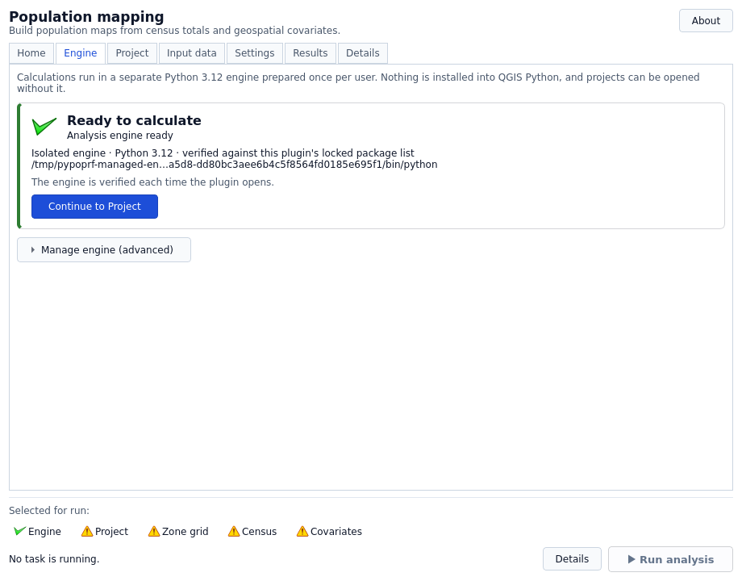

# Installation and updates

These instructions describe version **0.3.7**. Use a matching plugin ZIP or build
one from this checkout; older packages do not contain this workflow. A local ZIP
build is not publication to GitHub or the QGIS plugin repository.

## Before you start

| You need | Why |
| --- | --- |
| QGIS in the declared 3.44–4.x range | Hosts the interface and QGIS layers; local native acceptance targets 3.44 and 4.2. |
| A valid ZIP built from this checkout | Earlier released packages do not contain this UI/runtime workflow. |
| Separately installed 64-bit CPython 3.12 | Runs the isolated calculation engine; QGIS's Python may differ. |
| Network and writable user cache for initial setup | Downloads and verifies the locked binary wheels. |
| An analysis folder outside the installed plugin/cache | Keeps input data and completed runs independent of updates. |

Obtain QGIS from its [official download page](https://qgis.org/download/).
OSGeo4W is not a plugin requirement: the plugin does not depend on one particular
Windows installation method. It requires working QGIS/PyQt bindings for the
interface and a separate compatible calculation Python. Do not select QGIS's
embedded interpreter merely because it is installed on the same PC.

## Two separate components

The interface runs inside QGIS. Numerical processing runs in a dedicated, per-user **64-bit CPython 3.12** virtual environment. Enabling the plugin never runs pip, modifies QGIS Python, or imports the numerical libraries.

The declared range is QGIS 3.44–4.x. Native acceptance targets Windows AMD64 and Linux glibc x86_64 QGIS 3.44 / Qt 5 and QGIS 4.2 / Qt 6, each with a separate engine. macOS, ARM and musl are not qualified by this build. The [development guide](../development.md) explains the reproducible checks; private local qualification reports are not published as repository files.

## Install the plugin ZIP

1. Use a verified plugin ZIP matching this version, or, if working from source,
   build with `python scripts/build_plugin.py` from the repository root. Building
   the interface archive itself needs Python's standard library, not pip or QGIS.
   The resulting ZIP excludes datasets, tests and developer environments.
2. In QGIS, choose **Plugins → Manage and Install Plugins → Install from ZIP** and select the generated ZIP.
3. Enable pypopRF and open its dialog.
4. On **Home**, follow the next-step controls. On **Engine**, choose a recommended compatible Python from the discovered list, then choose **Set up engine**. If none is found, **Get Python 3.12…** explains the requirement and can open the official download page after confirmation. Install 64-bit Python 3.12, then **Find Python again**. Manual executable selection is an advanced option; selected files are checked asynchronously. A ready engine hides routine installation controls and offers the next workflow step instead.
5. Wait for binary-wheel SHA-256 verification, exact package-version, native-import and dependency checks to finish. Start analysis only when the engine is ready.

QGIS's [plugin-manager manual](https://docs.qgis.org/3.44/en/docs/user_manual/plugins/plugins.html#the-install-from-zip-tab)
describes the Install from ZIP control. Installing the archive normally feels
quick because it copies the interface files; it is not the numerical-package
installation step.

### Python choices and readiness

- **Checking…:** wait for the background check; this does not mean Python is absent.
- **Compatible Python listed:** use the recommended choice, then **Set up engine**.
  Selecting it installs nothing. Only compatible 64-bit CPython 3.12 choices are listed.
- **No compatible Python found:** use **Get Python 3.12…** for instructions and an
  explicitly confirmed official-page link, install it, then **Find Python again**.
  Python itself is never silently installed by the plugin.
- **Ready to calculate:** no setup action is required. Use the next-step button;
  repair/manual selection live under **Manage engine (advanced)**.
- **Failure:** read the inline message and **Details**. Do not resolve it by
  installing packages into QGIS. A failed repair keeps a previously verified
  engine only when that engine remains valid for the current lock.

Install a compatible Python from [the official Python releases](https://www.python.org/downloads/windows/)
on Windows. Choose the 64-bit CPython 3.12 installer, not simply the newest Python
major/minor version or a Store alias. Manual selection is an advanced recovery
route and asynchronously checks the executable before presenting it as compatible.

### GDAL and other numerical packages

QGIS uses its own geospatial libraries for QGIS work. The separate engine uses
the locked Rasterio binary wheel and its native GDAL support, along with locked
NumPy/pandas/scikit-learn dependencies. It does not require OSGeo4W's Python
GDAL bindings or a global `osgeo` package injected into the GUI process.
Rasterio's [installation guide](https://rasterio.readthedocs.io/en/stable/installation.html)
documents the bundled GDAL libraries and the wheels' driver/compatibility limits;
the plugin isolates and qualifies its pinned wheels rather than mixing them into QGIS.
Native imports and exact installed versions are checked during preparation.
Unsupported platforms without the expected wheels fail explicitly; this is not
a promise of working on every QGIS/OS/architecture combination.

Setup downloads the locked binary dependencies and needs network access, sufficient disk space and permission to write to the user's QGIS cache. It does not automatically download a Python interpreter. Install Python 3.12 separately from [python.org](https://www.python.org/downloads/) if necessary. On Windows, select `python.exe`, not `pythonw.exe` or the Microsoft Store alias.

The initial package installation can take several minutes. You can cancel it from the dialog. A failed or cancelled setup cannot replace a previously verified engine. The setup lock prevents two QGIS processes installing into the same cache concurrently.

## Update safely

1. Finish the current analysis, or cancel it and wait for the task to stop.
2. Use **Plugins → Manage and Install Plugins → Install from ZIP** to install the
   newly built ZIP. There is no need to uninstall the modern plugin first.
3. Reopen pypopRF and wait for the engine check. If the packaged dependency lock
   changed, open **Engine → Manage engine (advanced)** and choose
   **Repair / update engine**, then wait for verification.

For an interface-only update with the same compatible dependency lock, the existing
verified engine is reused; downloads are not required merely because the plugin
version changed. New engines use shorter unique directory names to reduce Windows
path-length failures; already verified legacy environments stay at their original
paths and remain reusable. No Windows long-path setting is changed automatically.
Your project is separate: select it on Project, click **Open
project**, then verify **Project open** and **Active project: …**. Merely choosing
the path does not activate it. See [Projects](../user-guide/projects.md).

Analysis and preparation jobs use a private, verified source snapshot and working
directory outside the installation. Unloading the plugin requests cancellation;
owned resources are released asynchronously after the child actually exits.
This protects the installed folder from those jobs, but updating in the middle
of an analysis is not a way to preserve or resume that analysis.

The active engine environment switches only after successful verification; old
environments are retained for recovery, not recursively deleted. A plugin ZIP
replacement and an engine update are different operations. QGIS's ZIP installer
does not guarantee rollback for an arbitrary incomplete plugin archive. Use a
ZIP built and verified by this repository, and keep the preceding valid ZIP.

Keep analysis projects outside the plugin installation and engine-cache directories.
The interface refuses project and preparation destinations inside these protected
locations before creating or activating them. This is a location safeguard, not
a substitute for backing up an existing legacy installation's data.
QGIS manages the installed plugin folder; uninstalling/replacing a plugin is not a
project-backup mechanism. Back up the project configuration and important completed
runs before changing an installation.

### One-time migration from a legacy Windows installation

An older plugin may have loaded numerical DLLs from its installation folder into
the QGIS process. Disabling the plugin cannot safely unload those DLLs. If this
is the installation you are replacing:

1. In **Installed**, uncheck pypopRF to disable it; do not uninstall it first.
2. Save your QGIS project and close **all QGIS instances using that profile**.
3. Reopen QGIS with pypopRF still disabled.
4. Install the valid new ZIP using **Install from ZIP**, then enable pypopRF.
5. Set up the separate engine and reopen your analysis project.

Normal QGIS process exit releases the old DLL locks. Do not force-unload DLLs,
kill unrelated processes, or manually delete a folder while QGIS still uses it.
If replacement still fails, stop and follow the [recovery checks](../user-guide/troubleshooting.md#plugin-update-or-locked-folder).

Existing project input files and earlier run directories are not replaced by an engine update. Model bundles have a strict schema and environment contract; old separate model/scaler files are deliberately not loaded. Retrain when moving to the new engine.

This build does not claim publication in the QGIS repository, automatic self-updates, or offline first-time dependency installation. Do not install dependencies into the QGIS Python environment to work around a setup error; use [troubleshooting](../user-guide/troubleshooting.md).

Next: [Quick start](quickstart.md).
