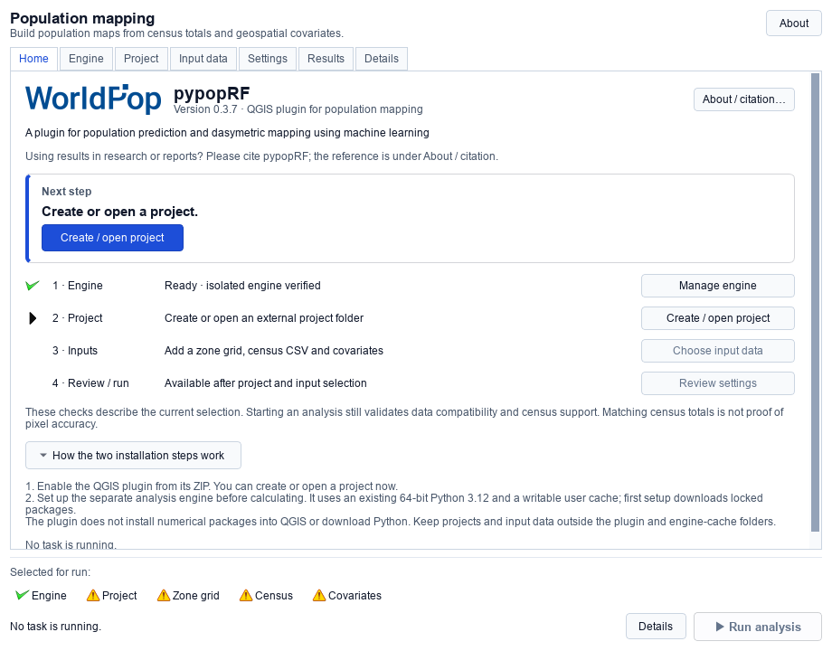

# QGIS pypopRF

pypopRF creates gridded population maps from census-zone totals and aligned
numeric raster covariates. The plugin was developed by the WorldPop SDI Team
and contains its own modified numerical core, related to the upstream pypopRF
work. The local implementation and configuration described here are the
contract for this plugin build.

The interface manages projects, inputs, an isolated analysis engine and run
history. Computation runs in a separate 64-bit Python 3.12 environment rather
than importing the numerical stack into QGIS. Existing projects and earlier
run results are preserved.

## Modernized development workflow

These guides describe the **0.3.5 development build** in this repository, not an
older released plugin. They are shipped with the ZIP; an already deployed website
may be behind this checkout until a separate documentation deployment occurs.

**Home → Engine → Project → Input data → Settings → Run analysis → Results**

Home provides the next step and project identity. Engine discovers compatible
Python and prepares the isolated environment. Project distinguishes a selected
folder from a successfully opened project. Inputs and settings remain gated until
activation. The checklist, task status and Run/Stop action stay below every tab;
Details retains diagnostics. All plugin windows use one independent light scheme.

## Start with your situation

| Situation | Guide |
| --- | --- |
| First installation or a missing calculation engine | [Installation and updates](getting-started/installation.md) |
| First calculation with prepared inputs | [Step-by-step quick start](getting-started/quickstart.md) |
| Existing project, a new folder, moving data or making a backup | [Projects](user-guide/projects.md) |
| Need to know what a control does | [Seven-tab interface](user-guide/interface.md) |
| Grids do not match, CSV fields differ or importing a filename fails | [Input data and preparation](user-guide/input-data.md) |
| Need sensible processing options or validation interpretation | [Settings](user-guide/settings.md) |
| Need completed maps, quality diagnostics or an AOI summary | [Running analysis and results](user-guide/running-analysis.md) |
| An error, locked folder or disabled action blocks progress | [Troubleshooting](user-guide/troubleshooting.md) |

## Start here

- [Installation](getting-started/installation.md): prepare the plugin and engine.
- [Quick start](getting-started/quickstart.md): create or open a project and run it.
- [Projects](user-guide/projects.md): selected folder, activation, storage and backups.
- [Interface](user-guide/interface.md): Home, Engine, Project, Input data, Settings, Results and Details.
- [Input data](user-guide/input-data.md): grid, census, covariates and optional masks/groups.
- [Settings](user-guide/settings.md): controls, target units and spatial validation.
- [Running analysis](user-guide/running-analysis.md): inspect completed outputs.
- [Troubleshooting](user-guide/troubleshooting.md): recover without deleting original data.
- [Development](development.md): architecture, checks and reproducible packaging.

## Calculation

When inputs need alignment, use the guided **Prepare / align inputs…** workflow
to create a separate derived project, not overwrite the originals. When a run
finishes, Results combines a saved-evidence quality dashboard, QGIS layer actions
and explicit cell-centre population summaries. These conveniences do not relax
the data or scientific contracts below.

1. Validate the complete raster alignment and population-table contracts.
2. Apply optional water exclusion to a temporary zone grid.
3. Extract covariate means and count eligible pixels independently of covariate order.
4. Fit and validate a seeded Random Forest using the selected target transform.
5. Predict density weights where the selected predictors are valid.
6. Allocate each census zone's total across eligible positive weights.
7. Read back population maps and verify the total of each zone before completion.

Optional population support produces a separate constrained map. Optional
age/sex tables produce group maps joined by zone ID, with each group's totals
checked separately. Missing support for positive population causes an explicit
failure rather than an apparently successful partial population map.

## What the results establish

Population outputs conserve the supplied totals within numerical tolerance.
That verifies allocation arithmetic, not fine-scale geographic accuracy. A
map can conserve every total while locating people incorrectly within zones.
Training on zonal means and applying the fitted model to pixels also involves
a change of spatial scale which requires independent validation.

The default model validation holds out centroid-based spatial blocks and
refits the full modelling procedure within each training fold. It records
block geometry and limitations, including the absence of separation buffers.
Scores refer to held-out zone-average density. Independent finer-resolution
population data are needed before making claims about pixel accuracy.

Each completed run records input-resource hashes, source-code hashes, effective
configuration, CV provenance and output-artifact metadata in its manifest and
associated files. The interface only presents verified complete runs as results.

## Project and attribution

Project development and issues are hosted at
[wpgp/QGIS-pypopRF](https://github.com/wpgp/QGIS-pypopRF).
Use [GitHub Issues](https://github.com/wpgp/QGIS-pypopRF/issues) for reproducible
reports, including diagnostics and the plugin/QGIS/engine versions.

Please preserve the authorship information in the repository's `CITATION.cff`
and use it when citing the software. See the repository
[LICENSE](https://github.com/wpgp/QGIS-pypopRF/blob/master/LICENSE) and individual
file notices for licensing information. The project's documented origins and
WorldPop SDI attribution remain unchanged by this modernization.
