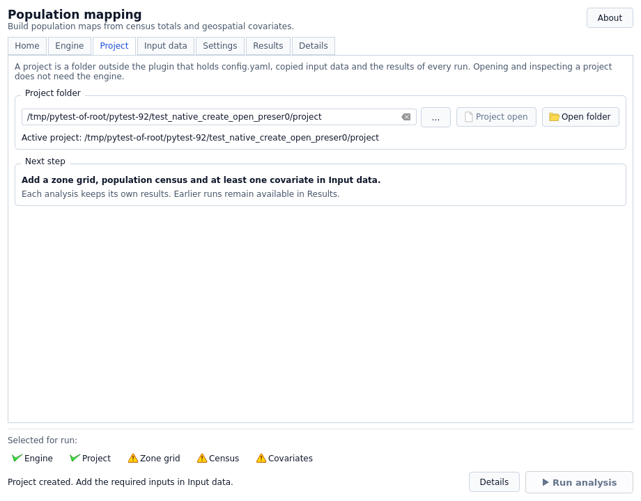

# Projects and storage

A pypopRF project is an analysis folder, not the installed plugin or the QGIS
`.qgz` project. It stores settings, imported data and independent runs. A QGIS
project can reference its maps, but cannot replace a backup of those files.

## Select, then activate

On **Project**, selection and activation are different:

| State | Button | Meaning |
| --- | --- | --- |
| No folder selected | Unavailable | Choose an external folder. |
| Selected folder has no `config.yaml` | **Create project** | Adds a configuration; unrelated existing files are retained. |
| Selected folder contains `config.yaml` | **Open project** | Validates and restores the saved configuration. |
| Selected folder is already active | **Project open** (disabled) | Activation is complete; no repeated Open is needed. |



Choosing another folder makes it a candidate, not an active replacement. Explicitly
Create/Open it before importing or running. The current-project label and Project
readiness item identify the active folder; **Open folder** opens its location in
the system file manager. Project inspection does not require the engine; analysis
and guided preparation do.

## New and existing folders

Create works in a new folder or an existing external folder without `config.yaml`.
It adds the configuration and data directory; it does not rename, delete or replace
unrelated files or automatically register them as inputs. Select appropriate
existing files explicitly.

If `config.yaml` exists, open it. Do not delete it to force Create or replace it
with an example merely because inputs are incomplete. Open reads/validates it
without resetting CSV mappings, predictor names or settings. Subsequent explicit
input/settings changes are saved; opening itself does not rewrite YAML.

Activation can create/append GUI diagnostics under `output/`. Thus configuration
read-only opening is not a promise that the whole folder is untouched. Existing
ordinary GUI logs append/rotate rather than truncate.

Project, configured data/output and GUI log locations must stay outside the plugin
installation and engine/job caches. An unsafe-location error does not move/delete
data: back it up and relocate the complete project yourself.

## Default storage

```text
study-project/
├── config.yaml                 current selections and settings
├── data/                       scientific inputs
└── output/
    ├── logs_pypoprf.log         GUI diagnostics, default filename
    └── runs/
        └── <run_id>/           one analysis attempt
            ├── manifest.json
            ├── run_config.yaml
            ├── population_unconstrained.tif
            └── ...            model, validation and other artifacts
```

A newly created project has no completed run. Failed/cancelled attempts may
contain diagnostics or partial artifacts, not final maps.

`data_dir` and `output_dir` can differ, including absolute paths. The GUI log still
uses `<project>/output/`, independently of analysis `output_dir`. See
[Settings](settings.md#paths-logs-and-model-files). Include configured external
locations when backing up or moving.

The current configuration is not an earlier run's provenance: each run saves its
effective `run_config.yaml`, fingerprints and manifest. Keep the complete run
folder, not just the TIFF, when you need to explain or reproduce an output.

## Inputs and history are not silently overwritten

Imports are staged in background jobs and registered after successful copy. A
filename collision requires verified reuse, a separately named copy, or Cancel.
Identical bytes alone are insufficient when raster resources are incompatible.
See [Quick start](../getting-started/quickstart.md#4-select-inputs-and-handle-filename-conflicts)
and [Input data](input-data.md#raster-grid-contract).

Clearing a field or deleting a covariate row removes the configuration reference,
not the copied file. The plugin does not recursively clean the data directory.
Re-running retains earlier runs; Stop is not an instruction to erase source data
or historical results.

**Prepare / align inputs…** creates a separate new project and derived inputs.
**Open prepared project** is an explicit later switch; the previous project remains
available. Add age-sex data after opening the prepared project, since the wizard
does not automatically migrate every optional file.

## Back up and move safely

1. Finish or Stop owned work and wait for it to end. Before editing configuration
   externally or moving the folder, save your QGIS project and close QGIS instances
   using those files: a hidden dialog can retain its logger and pending settings,
   and loaded raster layers can retain file handles.
2. Back up `config.yaml`, input resources and complete run folders you need. Include
   external configured directories and raster sidecars.
3. Copy/move the whole project to another safe external folder, not inside the
   plugin installation or engine cache.
4. Select the new location in pypopRF and choose **Open project**. Check displayed
   input paths, CSV mappings and available Results before running.
5. Correct genuine external/absolute references in a backed-up configuration or
   explicitly reselect inputs. Verify relocation before removing the old copy yourself.

Relative default `data/` and `output/` follow the selected folder in the GUI.
Opening a moved folder does not rewrite stored `work_dir`; GUI analysis uses the
active selected root for its new snapshot. If you use the headless API/CLI too,
check its configured `work_dir` and external paths separately. Earlier saved run
configurations retain their original provenance paths.

New run output names use portable `/` separators. Results also accepts legacy
Windows backslash separators for contained relative paths, so nested age-sex maps
remain visible after a Windows-to-Linux move. Drive/UNC paths, traversal and files
outside the run are still refused. This does not rewrite old input/provenance paths.

QGIS layers can still point to old files. Add the relocated project's completed
maps through **Results → Add maps to QGIS**, or update the QGIS project deliberately;
moving the folder does not rewrite `.qgz` layer sources automatically.

## Older configurations and CSV mappings

Compatible saved configurations retain their mappings. For example,
`census_id_column: zone_code` and `census_pop_column: total_people` refer to those
exact CSV headers, not defaults `id`/`pop`. Named `covariates` entries and filenames
must also remain meaningful. Review **Settings → Census columns** after opening;
the plugin does not rename the table.

Older/manually edited YAML may lack required fields or contain invalid types.
Not every historical configuration is automatically converted. Keep the original
folder/configuration and read the error in **Details**. See [Settings](settings.md)
for supported fields. If compatibility is uncertain, create a separate clean
project, explicitly select/import verified data, and re-enter their mappings;
do not destroy the old folder to make the new interface accept it. Legacy separate
model/scaler files are not a shortcut around retraining.

Each new analysis records its own settings and inputs. Completion/conserved totals
do not replace reviewing validation and support: see
[Validation and scientific limits](running-analysis.md#read-the-quality-dashboard).
