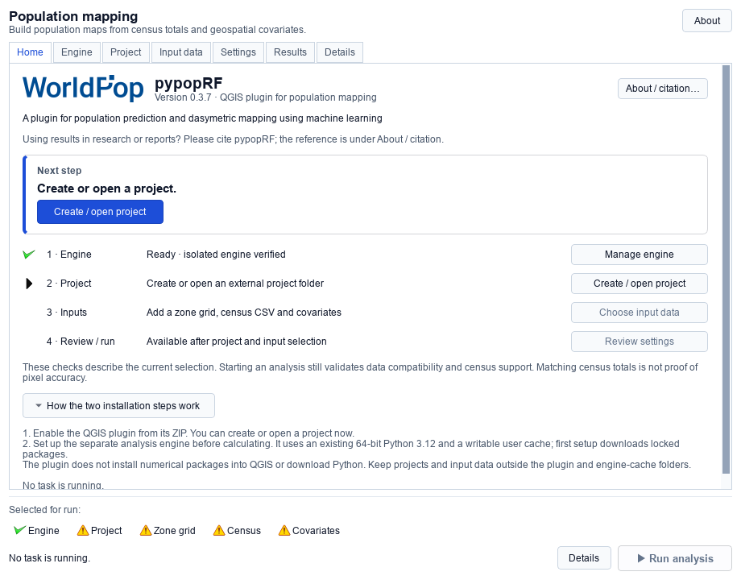
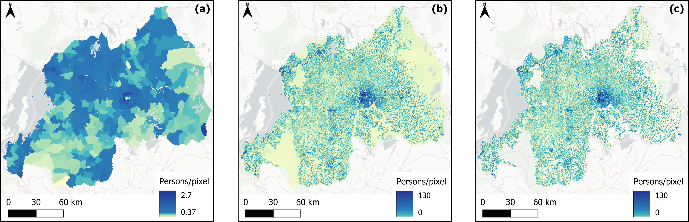

# Summary

Accurate data on the spatial distribution of population is an essential source of information to a wide range of environmental, health and sustainable developmental applications. Considerable work has been undertaken to develop modelled gridded datasets that accurately capture population distributions at subnational scales. However, generating these datasets demands specialised expertise in statistical modelling and computational programming. To overcome these challenges, the Spatial Data Infrastructure (SDI) Team at WorldPop have developed the QGIS pypopRF Plugin, a high-resolution population mapping tool that uses machine learning and dasymetric techniques within open-source GIS software [@QGIS_2025]. The plugin's numerical core is adapted from the pypopRF Python package [@Priyatikanto_2025] and modified for use within the plugin. It transforms census zone totals and aligned geospatial covariates into gridded population distribution maps using a random forest (RF) dasymetric modelling approach [@Stevens_2015], optionally incorporating water masks, spatial population support layers and age-sex data. A graphical interface enables non-technical users to implement top-down population disaggregation methods [@Wardrop_2018] without programming expertise. This paper aims to describe the core functionality and features of the QGIS pypopRF Plugin, and how the plugin can be leveraged to create high-resolution gridded population data.

# Statement of need

Globally, population dynamics display considerable variation across local-regional scales due to the interaction of a series of phenomena. Demographic trends [@OECD_2024], urbanisation [@Sun_2020], and migration patterns [@Qiao_2024] all shape human population distribution and change in distinct ways across countries and regions. In this setting, subnational population datasets are essential to capturing these dynamics and supporting a swathe of applications, including public health strategy, disaster risk management, urban planning and resource allocation [@Maneepong_2025; @Wardrop_2018].

However, generating gridded population typically requires expertise in statistical methods and programming skills [@Leyk_2019; @Tatem_2007]. In fact, tools that precede this plugin, pypopRF [@Priyatikanto_2025] and popRF for R [@Bondarenko_2021], are primarily operable at command-line or scripting level, thereby limiting accessibility to a wider community. Therefore, open-source and replicable tools for population modelling are crucial to bridging the gap between data curators and data users [@Mobasheri_2020].

The QGIS pypopRF Plugin addresses these challenges by providing an integrated tool accessible to GIS practitioners, analysts and educators/students. By making RF-based population modelling available through a guided QGIS interface, the plugin facilitates a consistent, reproducible workflow for gridded population data creation. Each analysis is saved in its own run directory together with its configuration, input and source-code hashes, validation records and output metadata, and earlier runs are never overwritten. This enhances the transparency of methods, enabling users to document and share model configurations as well as outputs.

# State of the field

There are several existing open-source tools and packages to support population disaggregation and dasymetric mapping through the implementation of RF methods. These include WorldPop’s R-based popRF package [@Bondarenko_2021] and the Python-based pypopRF package [@Priyatikanto_2025]. Whilst both popRF and pypopRF offer robust and reproducible implementations of RF-based population modelling, they are accessed via scripting or command-line workflows. This limits their accessibility to users without programming expertise, despite strong demand from GIS practitioners, analysts and students working in desktop GIS environments.

The QGIS pypopRF Plugin addresses this gap by making the population modelling workflow available within QGIS, a widely adopted open-source GIS platform. Whilst the plugin builds upon the dasymetric approach of the pypopRF package [@Priyatikanto_2025], it incorporates a modified version of the numerical core, and contributes a graphical interface, guided input preparation, workflow orchestration, logging and validation, and a data management layer tailored to applied geospatial analysis.

Separately from software tools, several global gridded population datasets are publicly available. These include the Global Human Settlement Layer population grids (GHS-POP), which disaggregate population data to grid cells at ~100m resolution using built-up area data [@Schiavina_2023; @Pesaresi_2024]; the High Resolution Settlement Layer (HRSL), which assigns census counts to settlement extents detected from high-resolution satellite imagery and machine learning algorithms [@Tiecke_2017]; and LandScan, which uses multi-variable dasymetric model to produce ambient global population distributions at ~1km [@Lebakula_2025]. WorldPop also publishes national gridded datasets produced with RF-based dasymetric methods [@Stevens_2015]. These are pre-produced data products with fixed inputs, reference years and resolutions. They are complementary to the plugin, which is a tool for producing new bespoke estimates from locally held census data and user-selected covariates, for the area, year and resolution a user needs, with documented diagnostics for each run.

# Software design
Architecturally, the plugin separates a QGIS interface from a numerical engine. The interface is a native PyQt tabbed dialog with seven pages: Home, Engine, Project, Input data, Settings, Results and Details \autoref{fig:user_interface}. Calculations run outside QGIS, within a private per-user Python 3.12 environment built from a hash-locked dependency. This keeps QGIS responsive, avoids loading numerical libraries into the QGIS Python environment, and allows analyses to be cancelled safely. The same engine can also be run headlessly from the command line.

The analysis implements a top-down dasymetric disaggregation method. Inputs are a zone raster (mastergrid) containing integer census-zone IDs, a census CSV with one population total per zone and one or more numeric covariate rasters on an identical grid; these are geospatial variables correlated with population distribution such as building footprints, infrastructure or elevation. Optional inputs are a water mask to exclude pixels, a population support layer (e.g. a human settlement footprint) to restrict a separate constrained allocation to supported areas, and an age-sex table of group totals by zone. Where inputs do not share a grid, a guided preparation workflow aligns covariates, or rasterises census polygons onto a reference grid and writes the result to a new project so that original data are preserved.

The RF model [@Stevens_2015] is trained at administrative unit level on the mean value of each covariate within each zone. The target is population density per eligible mastergrid pixel, log-transformed by default. The fitted model predicts a density weighting surface at the target resolution, and each zone's census total is then allocated across its eligible pixels in proportion to these weights, so that census totals are conserved. Every population raster is read back and checked against the supplied totals before a run is marked complete. Memory-efficient raster processing is achieved through tiled reading and writing, avoiding full in-memory loads for larger covariate datasets.

Conserving census totals verifies the allocation arithmetic but does not establish where people live within a zone. The plugin therefore provides validation diagnostics for every run. By default, zones are grouped into spatial blocks, each fold of blocks is held out in turn, and all model fitting, including scaling and covariate selection, uses the remaining zones only. The Results page reports held-out zone-density errors against a training-mean baseline, alongside permutation-based covariate importance. These scores describe zone-average density, not pixel-level accuracy, which requires independent finer-resolution population data to assess.

Each run is written to its own directory and produces GeoTIFF outputs \autoref{fig:outputs}: an unconstrained population distribution (persons per pixel) and, where a population support layer is provided, a constrained population distribution. Where age-sex data are supplied, a map is produced for each age-sex group. Alongside the maps, each run stores its configuration, a manifest of input and source hashes, the fitted model bundle, covariate importance scores, validation records and processing logs, enabling users to assess the relative influence of predictor variables and to reproduce the analysis.

The engine leverages rasterio [@Gillies_2019] for raster input and output operations, ensuring efficient handling of geospatial covariates. For data manipulation, pandas [@Pandas_2020] and its spatial extension geopandas [@Jordahl_2020] enable analysis of vector data associated with the raster information. To optimise performance, joblib [@Joblib_2025] is integrated for parallel processing, utilising multi-core processors. The foundational machine learning capabilities are provided by scikit-learn [@Pedregosa_2011], supporting the construction and application of the RF model. The plugin supports QGIS 3.44 and later and is qualified on Windows and Linux; macOS is not currently qualified. Its automated tests comprise headless engine tests on synthetic GeoTIFF and CSV fixtures (covering ID joins, NoData handling, grid alignment, conservation, cross-validation isolation and cancellation), and native tests inside QGIS, run through continuous integration.

Key design trade-offs were considered between computational efficiency, model accuracy and geospatial usability. This design is particularly relevant for research such as WorldPop's settlement modelling, in which gridded population estimates (~100m resolution) are used for tracking internally displaced populations and disaster response. The plugin is designed to be interpretable to aid peer review and transparency, whilst being scalable for iterative workflows in QGIS pipelines, promoting reproducible research in low-resource settings.

# Research impact statement

The QGIS pypopRF Plugin has been developed by the WorldPop SDI team to support the production of high-resolution population datasets across low- and middle-income country contexts. It directly supports WorldPop’s mission to enable transparent, reproducible, and locally adaptable population mapping, complementing existing global datasets with a tool for country-specific or subnational analysis.

The plugin is actively used within WorldPop workflows for method development and has also been applied in capacity-building settings to introduce population modelling concepts to GIS practitioners without programming experience. The continued use in operations and capacity building provides ongoing user feedback, supporting sustained development and ensuring the tool remains aligned with applied research needs. Given the widespread adoption of QGIS, the plugin is well positioned for broader uptake in research, training, and collaborative settings where accessible and reproducible methods are needed.

# AI usage disclosure

No generative AI tools were used in the development of this software, the writing of this manuscript, or the preparation of supporting materials.

# Acknowledgements

This work was supported by funds from the Gates Foundation (INV-045237 and INV-088965) and Wellcome Trust (308679/Z/23/Z). This work forms part of the outputs of WorldPop (www.worldpop.org). The funders had no role in study design, data collection and analysis, decision to publish, or preparation of the manuscript.

# References
